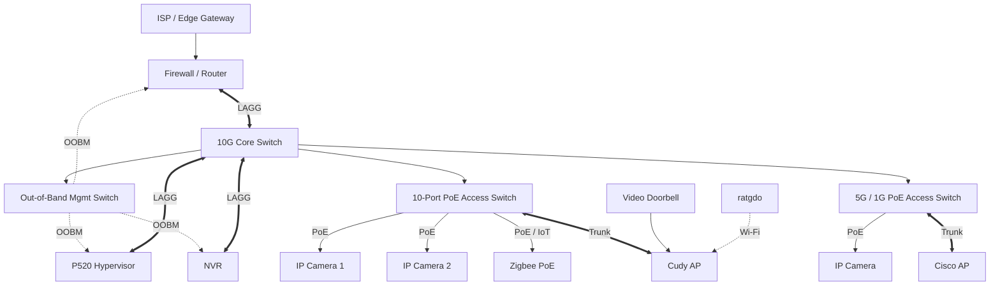

# Physical Network Layer

Hardware topology, switching fabric, cabling, and physical rack/device layout for the lab.

## Physical Topology

## Documentation Index

See the [Switch and Port Map](./switch-and-port-map.md) for port assignments and LAGG/trunk links.

Physical cable standards, [point-to-point links](./cabling-and-rack-layout.md), and hardware placement notes.